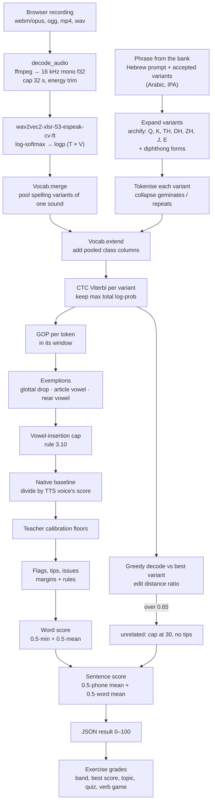
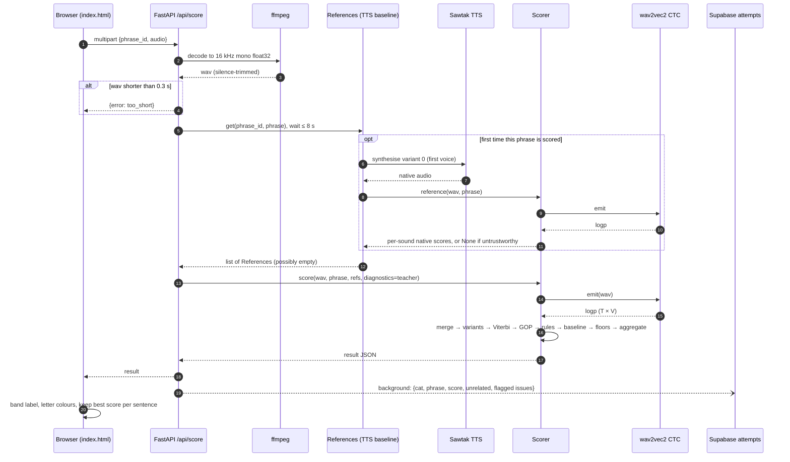
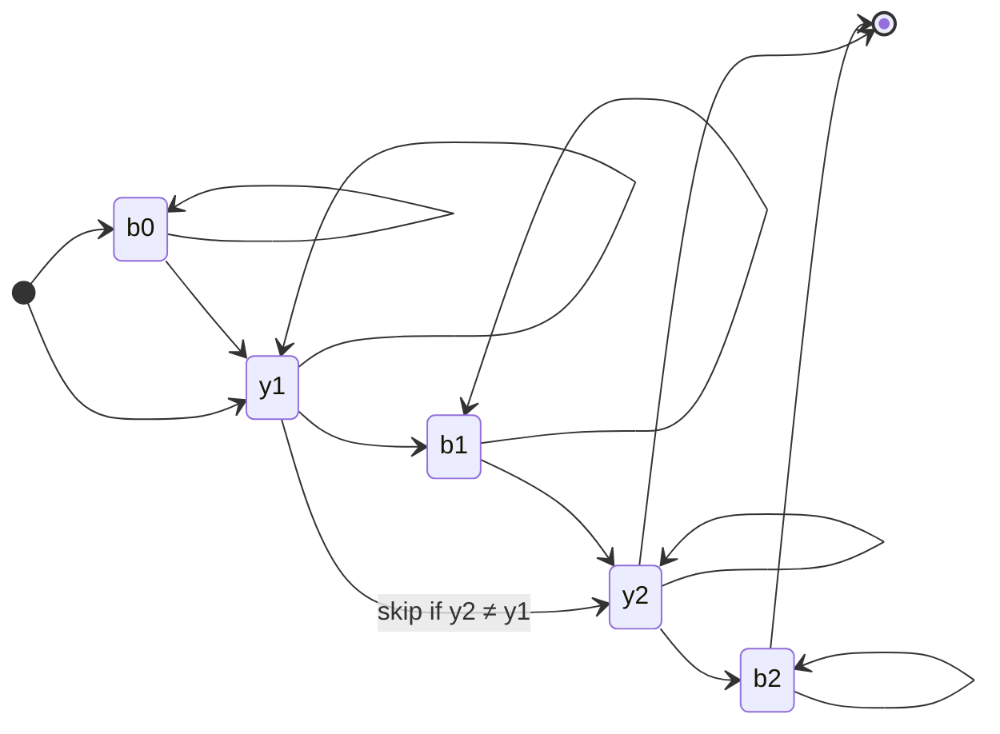
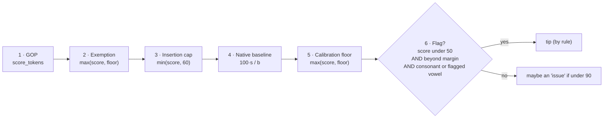
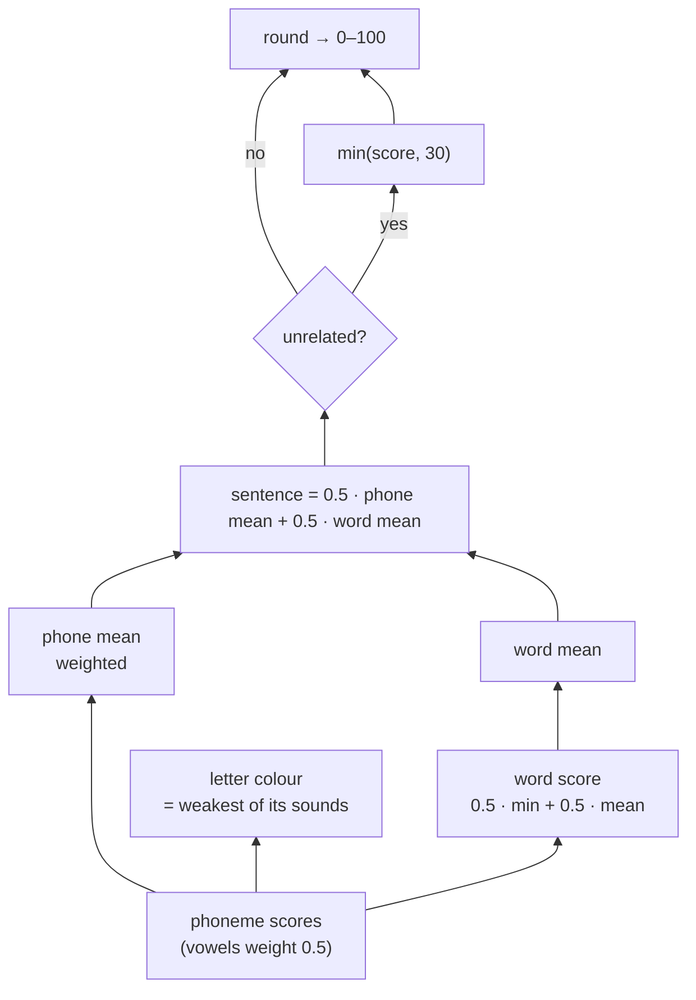
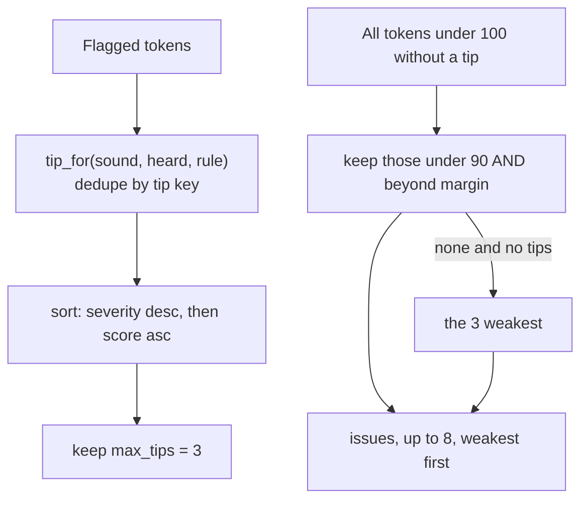
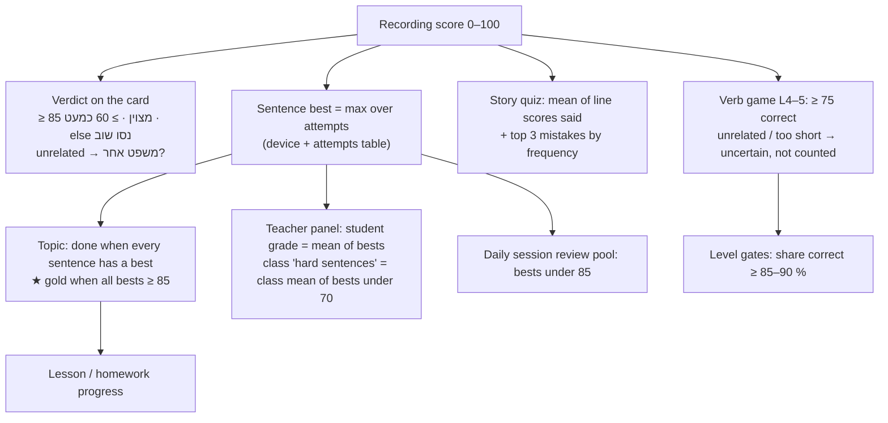

# How grading works: from a recording to an exercise grade

This document traces one recording through the scorer, from the audio bytes and the reference text to the numbers the student and the teacher see. It is written for a reader who knows CTC, forced alignment and GOP, and wants the exact formulas, thresholds and order of operations this codebase uses.

The pipeline has no ASR in it. The model never transcribes freely and then diffs against the text. Instead, the reference text is turned into phoneme sequences, the audio is force-aligned to each sequence, and each phoneme is scored by how strongly the model's posteriors support it inside its own time window.

| Stage | Where |
|---|---|
| Audio decode, silence trim | [app/scorer.py](../app/scorer.py) `decode_audio` |
| Phoneme posteriors (wav2vec2 CTC) | [app/scorer.py](../app/scorer.py) `HFEmitter` |
| Vocab pooling, many-ways letters | [app/scorer.py](../app/scorer.py) `Vocab`, [app/phones.py](../app/phones.py), [app/archi.py](../app/archi.py) |
| CTC Viterbi, GOP, greedy decode, edit distance | [app/align.py](../app/align.py) |
| Linguistic rules, exemptions, margins | [app/rules.py](../app/rules.py), [static/assets/pronunciation-rules.md](../static/assets/pronunciation-rules.md) |
| Native baseline from TTS | [app/reference.py](../app/reference.py) |
| Result assembly, word and sentence score | [app/scorer.py](../app/scorer.py) `Scorer.score_logp` |
| HTTP endpoint | [app/main.py](../app/main.py) `POST /api/score` |
| Exercise-level grades | [static/index.html](../static/index.html), [app/speech_evaluation.py](../app/speech_evaluation.py) |

---

## 1. The whole pipeline at a glance



## 2. Request sequence



The reference text never arrives from the client: the client sends only `phrase_id`, and the server looks up the phrase (bank phrase, teacher text line, or a verb-game form held server-side). That matters for the verb game, where the expected answer must not be exposed to the browser.

---

## 3. Inputs

### 3.1 Audio

`decode_audio` pipes the upload through ffmpeg (`-ac 1 -ar 16000 -f f32le -t 32`). It then trims leading and trailing silence with a 20 ms RMS envelope (320 samples). A sample counts as voiced if its envelope is above `max(0.01, 0.05 · peak)`. 200 ms of padding is kept on each side. The trim keeps CTC from being fed seconds of blank, which would otherwise widen the first and last tokens' GOP windows.

Anything shorter than 0.3 s after trimming is rejected before inference.

### 3.2 Reference text: a phrase and its accepted variants

A phrase in [app/phrases.py](../app/phrases.py) (and the generated workbook, grammar and teacher texts) carries a list of **accepted variants**, each `(arabic, ipa)`:

```python
dict(cat="meet", he="אני מירושלים", variants=[
    ("انا من القدس", "ʔ a n a | m i n | i l ʔ u d s"),
    ("انا من القدس", "ʔ a n a | m i n | i l q u d s"),
])
```

IPA phonemes are space-separated, words are separated by `|`, and the Arabic and IPA must have the same word count. A variant is a genuinely different correct sentence (different lexical choice, a dropped word, a different vowel pattern). Dialectal realisations of single letters are handled by the next step instead.

### 3.3 Variant expansion: many-ways letters ("archiphonemes")

Six Arabic letters have more than one correct Palestinian realisation. [app/archi.py](../app/archi.py) `archify()` aligns each word's Arabic letters to its IPA consonants (a small edit-distance DP with cheap skips for weak letters like ا و ي ة ل). It then rewrites the phoneme that came from such a letter as `SYMBOL:written`:

| Symbol | Letter | Accepted realisations (rules §5) |
|---|---|---|
| `Q` | ق | ʔ (urban), k (rural), q (also ok); g only if `optional_realisations_enabled` |
| `K` | ك | k, tʃ (rural) |
| `TH` | ث | t, θ; s only in learned words where the phrase writes s |
| `DH` | ذ | d, ð; z only in learned words where the phrase writes z |
| `ZH` | ظ | dˤ, zˤ, ðˤ |
| `J` | ج | dʒ, ʒ |
| `E` | final ة | a, e, i (positional) |
| `O` | pronoun ending | o, u (positional) |

So `ʔ a h w e` for قهوة becomes `Q:ʔ a h w E:e`. The written phoneme is kept for display, tips and calibration keys. The class membership is what gets scored.

Two more expansions:

- **Diphthongs** (§6.3 #8). `diphthong_variants()` adds a copy of the variant with `eː → a j` and `oː → a w` where the Arabic writes ي / و. A diphthong is two tokens instead of one, so it cannot be a class. It becomes a separate variant that competes in the Viterbi step.
- **Deduplication.** Variants that differ only in how a many-ways letter is said collapse into one after archifying.

A teacher can switch off any of these (the `dialect_*`, `final_vowel` and `diphthong` toggles). The scorer then requires the phoneme as written.

---

## 4. Acoustic model and vocabulary handling

### 4.1 Emissions

`HFEmitter` runs `facebook/wav2vec2-xlsr-53-espeak-cv-ft` (or a fine-tuned checkpoint via `MODEL_ID`) and returns `log_softmax(logits)`, shape `(T, V)`. That is ~50 frames/s (20 ms hop), V ≈ 392 espeak IPA symbols plus `<pad>` as the CTC blank.

Nothing downstream depends on torch. `Scorer` takes any `Emitter` callable, which is how [tests/test_scoring.py](../tests/test_scoring.py) drives the full scorer with synthetic posteriors.

### 4.2 Pooling spelling variants (`Vocab.merge`)

The multilingual vocab spells one sound several ways (`t / t̪ / tʰ / tː`, `r / ɾ`, `a / æ / ɐ`, `x / χ`). Left alone, a correctly said `t` would lose its GOP to its own allophone `t̪`. [app/phones.py](../app/phones.py) `base()` maps each symbol to a canonical sound by stripping length, aspiration, dentality, nasality and so on, and folding a fixed equivalence table. Emphatics stay distinct.

`merge()` replaces each group's columns with one representative column holding the group's `logsumexp`. The other columns are set to −1e9.

> A consequence: vowel length is invisible to the scorer, because `aː` and `a` share a base. Length errors can surface only through the margins and rules on the written phoneme, not through separate posteriors.

### 4.3 Class columns for many-ways letters (`Vocab.add_class`, `Vocab.extend`)

For a token like `Q:ʔ`, the scorer looks up each accepted realisation's model id (falling back via `FALLBACKS`, e.g. `ðˤ → zˤ → z`, when the vocab lacks a symbol). If more than one distinct id remains, it allocates a **virtual id** past the real vocab. `extend()` appends one column per virtual id: the `logsumexp` of its members' posteriors.

This implements rules §6.1. If P(ʔ)=0.35 and P(k)=0.40 in a frame, the `Q` column holds 0.75, and neither member is treated as a competitor of the other.

### 4.4 Tokenisation

`tokenize()` turns the archified IPA into a list of `TargetToken(phoneme, id, word, sound)`. Adjacent tokens with the same (canonical) id collapse into one, as in CTC. That means geminates (`m m`) become one token, and so do two neighbouring phonemes that map to the same sound. Gemination is therefore not scored (§6.3 #10).

---

## 5. Choosing the variant: CTC forced alignment

For every expanded variant, [app/align.py](../app/align.py) `ctc_viterbi()` runs the standard CTC Viterbi over the extended label sequence `blank, y1, blank, y2, …, yN, blank` (S = 2N+1 states). It allows stay, advance by one, and the skip `s−2 → s` when the label differs from `s−2`. The path must end on the last label or the trailing blank.

The result is `total_logp` (the best path's log-probability) and `spans[i] = [start, end)`, the frames where token *i* is emitted.



The variant with the highest `total_logp` wins (not length-normalised; all variants are scored against the same T frames). If T < N for every variant, the result is `error: too_short`.

> Example: قديش said with *k* aligns better to `Q a d d eː ʃ` than to an alternative wording. Because `Q` pools ʔ/k/q, the *k* realisation costs nothing.

---

## 6. Per-token scoring

Each token goes through a fixed sequence of stages. The teacher's diagnostic view (`trace.tokens[i].stages`) reports the score after each one.



### 6.1 Stage 1: GOP (`score_tokens`)

**Window.** Token *i*'s window runs from the end of token *i−1* to the start of token *i+1* (clamped to include its own span). It therefore contains the blank frames around the emission, which is where a substituted phoneme typically peaks when the path was forced through the target.


**Target peak.** `peak = max_t logp[t, target]` inside the window. For a class token this is the pooled column. `realised` names the member with the highest peak (used for dialect detection and display).

**Competitor.** Over the real columns only (no virtual columns), take each column's max inside the window. Then mask:
- the blank,
- the labels of tokens *i−1*, *i*, *i+1* and all their class members.

Neighbours are masked because coarticulation into the adjacent phoneme is not an error (§6.3 #11). The argmax of what remains is the competitor, and its max is `comp_peak`. If the competitor is outside the set of sounds the system can name (Arabic, Hebrew interference sounds, rule labels), it is reported as `other` instead of by name. Example: a click or a retroflex from the multilingual vocab.

**Score.**

$$
\text{gop} = \log p_{\text{target}} - \max(\log p_{\text{target}},\ \log p_{\text{comp}}) \;\le 0
$$

$$
\text{confidence} = \min\!\left(1,\ \frac{p_{\text{target}}}{0.30}\right)
$$

$$
\text{score} = 100 \cdot e^{\,\lambda\cdot \text{gop}} \cdot \sqrt{\text{confidence}}, \qquad \lambda = 0.5\ (\texttt{leniency})
$$

- With λ = 0.5 the ratio is square-rooted: a competitor twice as likely as the target gives 71, not 50. The zero-shot model is noisy on accented speech, so a linear ratio would punish the model's own uncertainty.
- The confidence term penalises a target that wins but only weakly. Below a peak posterior of 0.30, the score shrinks with √(p/0.3).
- A score of 100 requires the target to beat every non-neighbour competitor and reach p ≥ 0.30.

**Deletion.** `deleted = p_target < 0.05 AND p_comp < 0.20`: nothing clearly there, target or otherwise. A deleted token is reported as heard `_`.

**Worked numbers.** ħ said as a Hebrew ח (χ), with p(ħ) = 0.04 and p(χ) = 0.85 in the window:

| quantity | value |
|---|---|
| gop | ln(0.04 / 0.85) = −3.056 |
| e^(0.5·gop) | 0.217 |
| confidence | 0.04 / 0.30 = 0.133, √ = 0.365 |
| score | 100 · 0.217 · 0.365 ≈ **7.9** |
| deleted? | no (p_comp 0.85 ≥ 0.20) |

### 6.2 Stage 2: exemptions (rules §6.3)

These are cases the model hears as a mistake that are ordinary native speech. The first rule that applies wins ([app/rules.py](../app/rules.py) `EXEMPTIONS`):

| Exemption | Condition | Result |
|---|---|---|
| `glottal_dropped` | token deleted and its sound is ʔ or `Q` | 100 |
| `article_vowel_elided` | deleted vowel of ال right after a word ending in a vowel | 100 |
| `near_vowel` | vowel heard as same-group neighbour (i/e, u/o, a/ə/e) or other length | ≥ 90 (`near_vowel_floor`) |

A glottal stop replaced by another consonant is not exempt (only a deletion is), unless the class accepts it (ق → k).

### 6.3 Stage 3: vowel insertion inside a cluster (rule 3.10)

Hebrew speakers often break a word-internal consonant cluster with an epenthetic vowel (*katiir* for *ktiir*). For each pair of adjacent consonants in the same word (not the sentence's first cluster, and not when either is w or j), the scorer looks at the greedy (argmax) frames between the two consonants' spans. If at least `min_frames` = 2 frames have a vowel as argmax with p ≥ `min_peak` = 0.5, the second consonant's score is capped at `score_cap` = 60, and a severity-1 tip is attached.

### 6.4 Stage 4: native baseline

The phoneme model mishears some sounds even from natives (ʕ in على heard as dropped, l as r). A learner should not lose points for the model's weaknesses.

[app/reference.py](../app/reference.py) synthesises the phrase's first variant with a Palestinian TTS voice and scores it with the same `Scorer`. It keeps the per-sound scores, unless the fit is `unrelated` or the mean phoneme score is under `ref_min_mean` = 60, in which case the voice is not trusted. One voice is generated per phrase. Further voices are used only if already cached from playback. The score request waits up to 8 s for a reference, then proceeds without one.

Learner tokens are matched to reference tokens with `difflib.SequenceMatcher` on `(word, sound)` pairs. Sounds compare by symbol, so a reference that said ق as q is a valid baseline for a learner who says ʔ. Per learner token, `b` is the minimum score over all references that share that sound. Then:

$$
s' = \begin{cases} s & b \text{ is None or } b \ge 100 \\ \min\!\left(100,\ 100\cdot s / \max(b, 1)\right) & \text{otherwise} \end{cases}
$$

So a sound the TTS voice scores 40 on and the learner scores 40 on becomes 100. The baseline only ever raises scores. A word whose sounds were raised this way, and now all score ≥ 90, also shows the expected transliteration as "heard": the visible difference is one a native produces too.

### 6.5 Stage 5: teacher calibration floors

Confirmed tutor flags can become calibration rules `(expected, heard, phrase?) → floor`. A rule is looked up by sound symbol first, then by written phoneme, phrase-specific before global. It raises a matching token to `floor` and never lowers it. Applied floors are listed in `result.calibrated`.

The base multilingual model also has one conservative built-in calibration: when expected `ʕ` is classified as deleted (`_`), its score is raised to 60. This prevents a known false negative from producing a definite “ع was swallowed” warning, while retaining a meaningful penalty. An explicit teacher calibration for `ʕ → _` overrides this floor.

### 6.6 Stage 6: is it a mistake? Flags, margins, rules

Final per-token scores now exist. The decision to **flag** a token (show "heard as X" and a tip) needs all three of:

1. `score < flag_below` (50).
2. The competitor beats the target by at least the pair's **margin** (rules §6.2):
   - substitution: `−gop ≥ margin(target, heard)`
   - deletion: `p_target ≤ deleted_peak − margin(target, "_")` in log space
3. The token is a consonant, or a short vowel a rule explicitly flags. Currently that is only **u after a consonant in the same word** (rule 3.11). Other short vowels are never flagged (§6.3 #7).

Margins are natural-log ratios from the rules document:

| Target | Heard | Margin | Meaning |
|---|---|---|---|
| sˤ tˤ dˤ zˤ ðˤ | s t d z ð | 0.7 | plain must be ≈ 2× likelier (emphasis is weak in the base model) |
| h | `_` | 0.7 | h is short and quiet; natives reduce it too |
| ħ | h | 0.4 | ≈ 1.5× |
| long vowels | short | 1.1 | declared, but see the note below |
| everything else | | 0.0 | the competitor merely has to win |

> Margins on long-vowel targets are skipped at parse time (`"ː" not in t`), because `base()` drops length and the margin would otherwise land on vowel-quality pairs it was not meant for.

The **rule** for a substitution is looked up as `(target, heard)` in the `checks` of [static/assets/pronunciation-rules.md](../static/assets/pronunciation-rules.md). Example:

```yaml
id: pharyngeal_h
checks:
  - {target: ħ, heard: [χ, x], severity: 3, feedback: "…"}
  - {target: ħ, heard: [h, ɦ], severity: 2, feedback: "…"}
  - {target: ħ, heard: ["_"],  severity: 2, feedback: "…"}
```

Severity 3 means the error changes meaning (ħ/χ, ʕ/ʔ); 1 is accent. The rule chooses the Hebrew feedback text and the tip ordering. **It does not change the number.** The score is pure acoustics plus the stages above.

---

## 7. From tokens to words, letters and the sentence



**Word.** `word = 0.5 · min(phonemes) + 0.5 · mean(phonemes)` (`word_min_weight`). One bad sound drags its word down hard, but not to zero.

**Sentence.**

$$
\text{phone\_mean} = \frac{\sum_i w_i s_i}{\sum_i w_i},\quad w_i = \begin{cases}0.5 & \text{vowel}\\ 1 & \text{consonant}\end{cases}
\qquad
\text{overall} = 0.5\cdot\text{phone\_mean} + 0.5\cdot\overline{\text{word}}
$$

The word term exists so that a single wrong consonant moves a sentence from "excellent" to "almost". A plain phoneme mean would dilute it across all the correct sounds.

**Letters.** For display, the Hebrew-letter transliteration of each word is mapped back to the tokens that carry each letter (`_carriers`, `word_letters`). Each letter gets the minimum score among its tokens. A letter under `LETTER_GOOD` = 75 also carries `why` (what the sound was heard as) and `tip`. The page colours letters ≥ 75 / ≥ 50 / below.

### 7.1 Worked example

A hypothetical phrase `w eː n | i l ħ a m m aː m` ("where is the bathroom"), with ħ said as χ as in §6.1. Geminate `m m` is one token.

| word | tokens and scores | mean | min | word score |
|---|---|---|---|---|
| ween | w 100 · eː 95 · n 100 | 98.3 | 95 | 96.7 |
| ilħammaam | i 100 · l 100 · **ħ 7.9** · a 96 · m 100 · aː 92 · m 100 | 85.1 | 7.9 | **46.5** |

- phone_mean = (5·100 + 7.9 + 0.5·(95+100+96+92)) / (6 + 4·0.5) = 699.4 / 8 = **87.4**
- word_mean = (96.7 + 46.5) / 2 = **71.6**
- overall = 0.5·87.4 + 0.5·71.6 = **79.5 → 80**, which the page labels "כמעט" (almost).

With phoneme averaging alone, the same recording would score 87 and be called excellent.

ħ is flagged: 7.9 < 50, the margin for (ħ, χ) is 0, so −gop = 3.06 ≥ 0, and ħ is a consonant. The rule `pharyngeal_h` gives a severity-3 tip.

---

## 8. "Different sentence?" detection

Forced alignment always produces a path, even for the wrong sentence. To catch this, the scorer greedy-decodes the posteriors (argmax per frame, collapse repeats, drop blanks; real columns only). It then computes the Levenshtein distance to the chosen variant's token ids, with class members counting as equal.

$$
\text{unrelated} = \frac{\text{edit\_distance}}{N_{\text{tokens}}} > 0.65
$$

If unrelated, the sentence score is capped at 30, no tips or issues are produced, letters get no reasons, and the page shows "משפט אחר?". It also covers hesitations and restarts (§6.3 #14). The greedy decode is returned as `heard_ipa`. The Hebrew-letter rendering of what was heard (`heard_tr`) is built by cutting the greedy sequence at the aligned word starts.

---

## 9. Feedback selection



- **Tips** are the flagged substitutions with a rule, most severe first (meaning-changing before accent), then lowest score. At most 3 (4 with the `tips_by_severity` toggle off).
- **Issues** explain any score short of 100. Every imprecise sound not already covered by a tip, so the student never sees 94 with no reason.
- **Dialect.** If the accepted realisations used are all urban-only or all rural-only, the result carries `dialect`. If they disagree, it carries `mixed_dialect`. Either way this is informational and never affects the score (§6.3 #12).

---

## 10. The response

```jsonc
{
  "score": 80,                          // sentence, 0–100
  "variant": {"ar": "...", "tr": "...", "ipa": "..."},  // the chosen accepted variant
  "heard_ipa": "w e n i l χ a m a m",   // greedy decode
  "heard_tr": "...",                    // the same in Hebrew letters
  "unrelated": false,
  "words": [{
    "ar": "...", "tr": "...", "heard_tr": "...", "score": 46.5,
    "letters":  [{"t": "חַ", "score": 7.9, "why": "...", "tip": "..."}],
    "phonemes": [{"ipa": "ħ", "word": 1, "score": 7.9, "flagged": true, "heard": "χ"}]
  }],
  "tips":   [{"key": "...", "title": "...", "text": "...", "severity": 3, "word": "...", "score": 8}],
  "issues": [{"sound": "...", "word_tr": "...", "score": 92, "missing": false, "heard": "..."}],
  "references": 1,                       // native baselines used
  "dialect": "urban",                    // or "mixed_dialect": true
  "calibrated": [ ... ],                 // only if a teacher floor applied
  "phoneme_heatmap": { ... },            // teachers only: max-pooled posteriors, ≤ 180 columns
  "trace": { ... }                       // teachers only: every stage, threshold and intermediate value
}
```

`trace` is the place to start when debugging a surprising score. Its full schema is [docs/trace-schema.ts](trace-schema.ts), and the trace dashboard ([static/trace.html](../static/trace.html), "לוח אבחון" in the lab and the phoneme dialog) draws it: the frames around a sound with its window, its score stage by stage, the candidate readings and the unrelated gauge, and the sentence with its aggregation. It holds the candidate variants with their path log-probs, the unrelated ratio, and per token: window, p_target, competitor, gop, confidence factor, each stage's score, margin needed vs. got, rule, and whether the token became a tip or an issue.

---

## 11. From a recording's score to exercise grades

The scorer grades one recording. Everything above that level is aggregation, mostly on the client.



| Exercise | Grade | Where |
|---|---|---|
| Single sentence | The recording's `score`; band 85 / 60 | `index.html` (`EXCELLENT = 85`) |
| Sentence progress | Best score over all attempts. Any non-empty recording, including an unrelated one, marks the sentence as practised | `keepScore` |
| Topic | Practised count / total; gold if every best ≥ 85 | `tally()` |
| Story quiz ("בוחן") | Arithmetic mean of the lines' scores. One recording per line, no retries | `quizEnd()` |
| Verb game, levels 4–5 | `correct` if score ≥ 75. `unrelated` or too short → `outcome: "uncertain"`, `counts_as_attempt: false`, never a grammar error | [app/speech_evaluation.py](../app/speech_evaluation.py) |
| Verb game, unlocking | Correct ratio ≥ `VERB_THRESH` (0.85–0.90) over a minimum number of attempts | `index.html` |
| Arabic → Hebrew translation | Not scored by this pipeline: browser `he-IL` ASR, share of expected words heard in order, 0.8 = correct. Not stored | `index.html` (`HE`) |
| Teacher panel | Student grade = mean of their best scores; class difficulty per sentence = mean of students' bests | `index.html`, `/api/class` |

Verb game levels 1–3 (choice and matching) are graded server-side by exact match against a stored answer, with no audio involved.

---

## 12. Configuration reference

The values live in code, not in the rules document. The `scoring:` block of `pronunciation-rules.md` is read for **`margins`, `margin_default` and `max_tips` only**. Its other keys (`flag_below`, `bands`, `sentence_score`, `severity_weight`, …) are documentation. Its `sentence_score` string (`mean(word_min)`) also describes an older word formula; the code uses `0.5·min + 0.5·mean`.

| Knob | Default | Effect |
|---|---|---|
| `GopConfig.leniency` | 0.5 | exponent on the target/competitor ratio |
| `GopConfig.confident_peak` | 0.30 | target posterior above which confidence stops lowering the score |
| `GopConfig.deleted_peak` / `deleted_comp` | 0.05 / 0.20 | deletion thresholds |
| `ScorerConfig.flag_below` | 50 | max score for a flag and tip |
| `ScorerConfig.issue_below` | 90 | max score to be listed as an issue |
| `ScorerConfig.near_vowel_floor` | 90 | floor for neighbouring vowel qualities |
| `ScorerConfig.word_min_weight` | 0.5 | weight of the weakest phoneme in a word |
| `ScorerConfig.unrelated_ratio` | 0.65 | edit-distance ratio for "different sentence" |
| `ScorerConfig.ref_min_mean` | 60 | minimum mean for a TTS reference to be trusted |
| vowel weight | 0.5 | in the sentence phone mean (hard-coded) |
| unrelated cap | 30 | hard-coded |
| `LETTER_GOOD` | 75 | letter colour / reason threshold |
| insertion `min_peak`, `min_frames`, `score_cap` | 0.5, 2, 60 | rule 3.10, from the rules document |

Teachers can switch off each rule-derived behaviour at runtime (the **ניטור** tab, `rules.TOGGLES`). Switching one off restores the pre-rules behaviour for that aspect from the next recording on.

---

## 13. Known limitations

- **Zero-shot model.** The base model was not trained on Palestinian Arabic or Hebrew-accented speech. The native baseline and margins compensate partially; fine-tuning ([train/finetune.py](../train/finetune.py)) on teacher and labelled learner recordings is the intended fix.
- **Duration is not modelled.** CTC posteriors are peaky and collapse repeats, so vowel length and gemination are effectively unscored.
- **Fallback symbols.** If the vocab lacks a phoneme (e.g. `ðˤ`), it is scored as its stand-in. `/api/health` → `phoneme_fallbacks` lists these, and the contrast they lose cannot be detected.
- **GOP is max-pooled, not frame-summed.** Using window peaks makes the score robust to alignment jitter, but a brief spurious competitor spike can still win the window.
